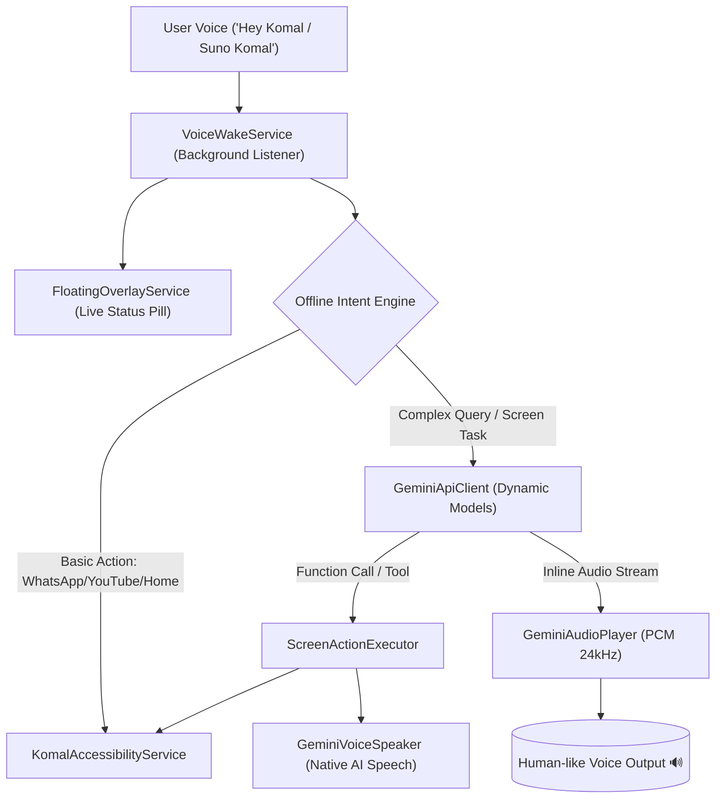

# Komal AI - Voice-Activated Autonomous Android Phone Controller 📱🎙️✨

[](https://github.com/raufzen/KomalAI/actions/workflows/build-apk.yml)
[](https://github.com/raufzen/KomalAI/releases/latest)
[](https://kotlinlang.org)
[](https://ai.google.dev)
[](#bilingual-support)

**Komal AI** is an intelligent, voice-activated autonomous AI assistant and phone controller designed specifically for Android. Operating via the **Android Accessibility Service** and Google's latest **Gemini API (Native Audio & Tool Calling)**, Komal AI allows you to control your phone completely hands-free — navigating applications, searching & playing YouTube, automating WhatsApp chats, scrolling, typing, and handling system tasks in conversational **Hinglish** and **English**.

---

## 🌟 Key Highlights

### 1. 🎙️ 100% Gemini AI Native Voice (Zero Robotic Local TTS)
- **No more mechanical, robotic Android TTS!** Komal AI synthesizes spoken audio natively via the Google Gemini API (`responseModalities: ["AUDIO"]` and `speechConfig`).
- Natural, human-like voice feedback powered by Gemini voice personas:
  - **Aoede** (Warm, friendly, natural — Default)
  - **Kore** (Clear, articulate, calm)
  - **Puck** (Playful, energetic)
  - **Charon** (Deep, resonant)
  - **Fenrir** (Bold, authoritative)
- Spoken audio is played through a high-fidelity 24,000Hz PCM audio pipeline with smart local caching for instant response.

---

### 2. 🧠 Independent 3-Way Model Selection
Pick and customize models independently for each specific workload directly from the dynamic Gemini Model Hub:
1. **Phone Controller Brain Model**: Model used for analyzing screen hierarchy, reasoning, and triggering accessibility tool calls (e.g., `gemini-2.0-flash` or `gemini-1.5-pro`).
2. **Dedicated Voice Output Model**: Specialized low-latency model tuned for real-time speech generation.
3. **Test Console Playground Model**: Dedicated model for testing custom commands, prompts, and tool responses before activating background listeners.

---

### 3. 🌐 Bilingual Support: Hinglish (Default) & English
- Full dual-language support tailored for everyday use:
  - **Hinglish (Recommended / Default)**: Conversational Hindi written in Roman/Latin script (e.g., *"Rahul ko WhatsApp par Hello bhej do"*, *"YouTube pe Arijit Singh ke gaane chalao"*).
  - **English**: Fluent, natural English (*"Open WhatsApp and send message to Rahul"*, *"Play classic rock on YouTube"*).
- Instant one-tap language switcher directly on the **Dashboard** and in **Voice Settings**.
- Assistant responses and screen notifications strictly adhere to clean Latin alphabet Hinglish/English — avoiding cluttered Devanagari script for maximum readability and universal compatibility.

---

### 4. ⚡ Offline Fast Mode
- Common everyday commands are recognized and executed instantly **100% offline** via the Android Accessibility Service without API round-trips:
  - *"Open WhatsApp"* / *"WhatsApp kholo"*
  - *"Open YouTube"* / *"YouTube kholo"*
  - *"Open Camera"* / *"Camera open karo"*
  - *"Go Home"* / *"Home screen par jao"*
  - *"Recent apps"* / *"Back"* / *"Scroll down"* / *"Scroll up"*

---

### 5. 🤖 Full Autonomous Phone Navigation & Automation
- **WhatsApp Automation**: Komal searches your contacts, opens the conversation, writes your dictated message, and automatically triggers the Send button.
- **YouTube Playback**: Searches for songs, artists, or videos and starts playback immediately.
- **On-Screen Clicks & Scrolling**: Reads screen nodes dynamically to click buttons, input fields, checkboxes, and navigate menus hands-free.
- **Dynamic Floating Assistant Pill**: A sleek, non-intrusive floating overlay pill appears when awakened, showing live speech transcription and action status in real-time.

---

### 6. 🔄 Seamless In-Place Updates & Permanent Keystore
- Releases are compiled and signed with a permanent static keystore (`app/keystore.jks`), allowing you to install new updates directly over previous builds without uninstalling or losing data.
- Built-in **In-App Auto-Update Checker** alerts you whenever a new version is released on GitHub with a single-tap direct download and install.

---

## 🏗️ Architecture



---

## 🗣️ Common Voice Commands

| Category | Hinglish Command | English Command |
|---|---|---|
| **WhatsApp** | *"Hey Komal, WhatsApp open karke Rahul ko Hello bhejo"* | *"Hey Komal, send Hello to Rahul on WhatsApp"* |
| **YouTube** | *"Hey Komal, YouTube pe Arijit Singh ke songs chalao"* | *"Hey Komal, play Arijit Singh on YouTube"* |
| **Navigation** | *"Hey Komal, home screen par jao"* | *"Hey Komal, go to home screen"* |
| **Recents** | *"Hey Komal, recent apps kholo"* | *"Hey Komal, show recent apps"* |
| **Scrolling** | *"Hey Komal, niche scroll karo"* | *"Hey Komal, scroll down"* |
| **General Apps** | *"Hey Komal, Camera open karo"* | *"Hey Komal, open Camera"* |
| **News** | *"Hey Komal, aaj ki top news sunao"* | *"Hey Komal, what's today's top news?"* |

---

## 🚀 Download & Installation

### Option 1: Direct APK Download
Download the latest pre-compiled release APK directly to your phone:
- 📥 **[Download Komal AI APK (GitHub Releases)](https://github.com/raufzen/KomalAI/releases/latest)**

### Option 2: Build from Source
1. Clone this repository:
   ```bash
   git clone https://github.com/raufzen/KomalAI.git
   cd KomalAI
   ```
2. Build via Gradle:
   ```bash
   ./gradlew assembleRelease
   ```
   The APK will be located at `app/build/outputs/apk/release/app-release.apk`.

---

## ⚙️ Initial App Setup

1. **Accessibility Service**:
   - Go to `Android Settings > Accessibility > Downloaded Apps > Komal AI Phone Controller` and toggle **ON**.
2. **Display Over Other Apps**:
   - Grant overlay permission to allow the floating status pill to show while using other apps.
3. **Microphone**:
   - Grant microphone permission for wake-word and voice command recognition.
4. **Google Gemini API Key**:
   - Open the **Gemini AI** tab in Komal AI.
   - Paste your free Google AI Studio API key and tap **Fetch Available Models**.
   - Select your **Controller Model** (e.g. `gemini-2.0-flash`) and **Voice Model**.
5. **Language Preference**:
   - On the **Dashboard**, tap **Hinglish (Recommended)** or **English**.

---

## 📄 License
This project is open-source and available under the [MIT License](LICENSE).
