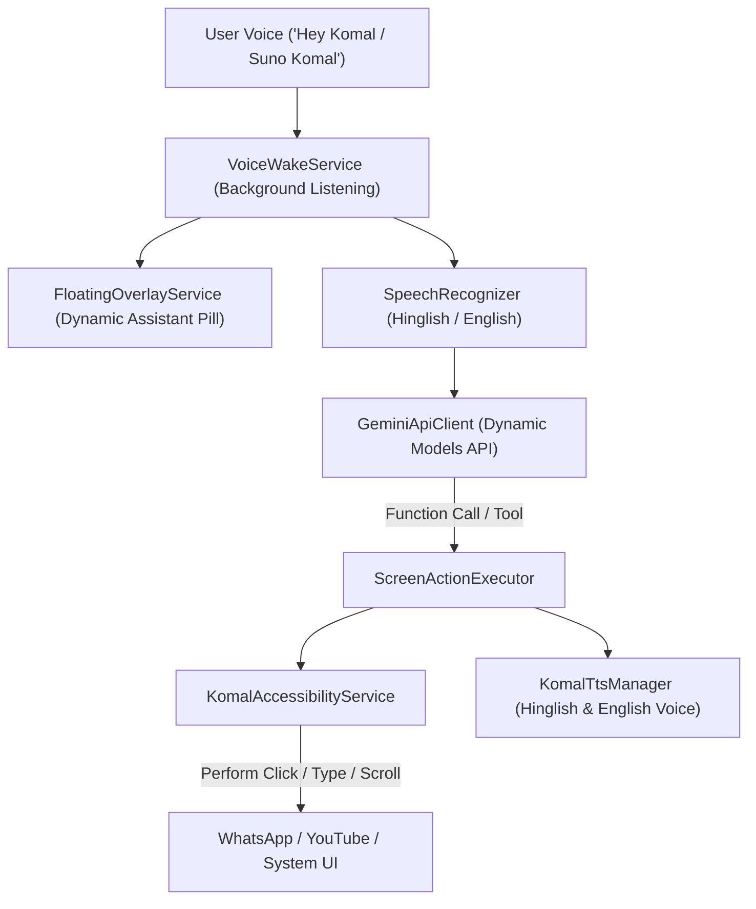

# Komal AI - Voice-Activated Autonomous Phone Controller 📱🎙️

[](https://github.com/raufzen/KomalAI/actions/workflows/build-apk.yml)
[](https://github.com/raufzen/KomalAI/releases/latest)
[](https://kotlinlang.org)
[](https://ai.google.dev)

**Komal AI** is an advanced, voice-activated autonomous AI assistant and phone controller for Android. Powered by the **Android Accessibility Service** and **Google Gemini API**, it enables hands-free phone control, intelligent screen navigation, messaging, music/video playback, and daily assistance in **Hinglish & English**.

---

## 🌟 Key Features

1. **Dynamic Gemini API Model Selector**:
   - Provide your Google Gemini API key, and Komal AI automatically fetches all available models (`gemini-2.0-flash`, `gemini-1.5-pro`, `gemini-1.5-flash`, etc.) in real-time.
   - Choose your **Phone Controller Brain** (for high reasoning and tool calling) and **Fast Voice Model** (for instant low-latency speech feedback).

2. **Bilingual Support: Hinglish & English**:
   - Seamlessly switch between **Hinglish** (e.g., *"YouTube pe songs chalao"*, *"Rahul ko WhatsApp message bhej diya"*) and **English** (*"Playing songs on YouTube"*, *"Message sent"*).
   - Natural Text-to-Speech (TTS) with customizable pitch and speech rate.

3. **Background Voice Wake-up ("Hey Komal" / "Suno Komal")**:
   - Runs in the background as a lightweight Foreground Service.
   - Hands-free trigger with customizable wake phrases: *"Hey Komal"*, *"Suno Komal"*, *"Komal"*, or *"OK Komal"*.
   - Sleek **Floating Dynamic Pill / Bubble Overlay** appears on wake-up showing live transcription and execution status.

4. **Autonomous Phone Control via Accessibility Service**:
   - **WhatsApp Automation**: Searches contacts, types messages, and automatically taps the Send button.
   - **YouTube Automation**: Launches YouTube and immediately plays your requested song or video.
   - **Today's News**: Fetches and narrates today's top news summaries.
   - **Screen UI Automation**: Detects on-screen buttons, text inputs, clickable elements, and performs taps and scrolling.
   - **System Actions**: Home, Back, Recent apps, Notifications.

5. **Modern Material 3 UI (Jetpack Compose)**:
   - Cyberpunk-inspired dark theme with status indicators, permission managers, API key hub, and interactive test console.

---

## 🏗️ System Architecture



---

## 📂 Project Structure

```
KomalAI/
├── app/
│   ├── build.gradle.kts
│   └── src/main/
│       ├── AndroidManifest.xml
│       ├── res/
│       │   ├── xml/accessibility_service_config.xml
│       │   └── values/strings.xml
│       └── java/com/komal/ai/
│           ├── KomalApp.kt
│           ├── accessibility/
│           │   ├── KomalAccessibilityService.kt   # Screen reader, clicker & gestures
│           │   └── ScreenActionExecutor.kt         # WhatsApp, YouTube & app automations
│           ├── gemini/
│           │   ├── GeminiApiClient.kt             # Dynamic model loader & agent tool calling
│           │   └── GeminiModels.kt                # Data models
│           ├── service/
│           │   ├── VoiceWakeService.kt            # Continuous background wake-up service
│           │   └── FloatingOverlayService.kt       # Dynamic floating pill UI
│           ├── tts/
│           │   └── KomalTtsManager.kt             # Hinglish & English TTS engine
│           ├── data/
│           │   └── PreferencesManager.kt          # Settings & cached models storage
│           └── ui/
│               ├── MainActivity.kt                # Main container & bottom navigation
│               ├── theme/                         # Material 3 colors & typography
│               └── screens/
│                   ├── DashboardScreen.kt         # Permissions & master toggle
│                   ├── GeminiSettingsScreen.kt    # API Key & dynamic model picker
│                   ├── VoiceSettingsScreen.kt     # Hinglish/English selector & wake word
│                   └── TestConsoleScreen.kt       # Interactive testing terminal
├── .github/workflows/
│   └── build-apk.yml                              # Automated APK compilation CI/CD
├── gradle/libs.versions.toml
├── build.gradle.kts
└── settings.gradle.kts
```

---

## 🚀 Download & Installation

### Option 1: Direct APK Download
Download the pre-compiled APK directly from GitHub Releases:
- 📥 **[Download Latest Komal AI APK](https://github.com/raufzen/KomalAI/releases/latest)**

### Option 2: Build from Source
1. Clone this repository:
   ```bash
   git clone https://github.com/raufzen/KomalAI.git
   ```
2. Open the project in **Android Studio**.
3. Select `Build > Build Bundle(s) / APK(s) > Build APK(s)`.

---

## ⚙️ Setup & Permissions

1. **Accessibility Service**:
   - Navigate to `Settings > Accessibility > Komal AI Phone Controller` and enable it.
2. **Display Over Other Apps (Overlay)**:
   - Enable overlay permission to allow the floating dynamic pill to show on top of apps.
3. **Microphone**:
   - Grant audio recording permission for voice recognition.
4. **Gemini API Key**:
   - Go to the **Gemini AI** tab inside the app.
   - Enter your Google Gemini API Key and tap **Fetch Models**.
   - Select your preferred Controller Model and Voice Model.
5. **Language Preference**:
   - Go to the **Voice** tab and choose **Hinglish** or **English**.

---

## 🗣️ Voice Commands Examples

Once the background service is running, just say:
- *"Hey Komal, WhatsApp open karke Rahul ko Hello bhejo"*
- *"Hey Komal, YouTube pe Arijit Singh ke gaane chalao"*
- *"Hey Komal, aaj ki top news batao"*
- *"Hey Komal, open Camera"*
- *"Hey Komal, go to Home screen"*
