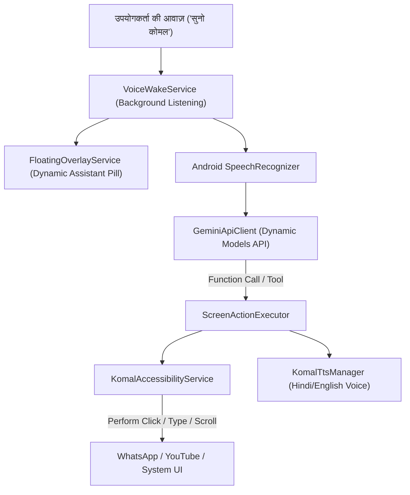

# Komal AI - Voice-Activated Autonomous Phone Controller 📱🎙️

**Komal AI (कोमल एआई)** एक उन्नत, वॉयस-सक्रिय (Voice-Activated) और हैंड्स-फ्री एंड्रॉइड असिस्टेंट ऐप है, जो **Android Accessibility Service** और **Google Gemini API** की शक्ति का उपयोग करके पूरे फ़ोन को नियंत्रित करता है।

---

## 🌟 मुख्य विशेषताएं (Core Features)

1. **डायनामिक Gemini API मॉडल चयन**:
   - जैसे ही आप अपनी Google Gemini API Key दर्ज करेंगे, ऐप सीधे Google के सर्वर से सभी उपलब्ध मॉडल्स (`gemini-2.0-flash`, `gemini-1.5-pro`, `gemini-1.5-flash` आदि) को लाइव लोड कर लेगा।
   - आप **फ़ोन कंट्रोलर ब्रेन** (उच्च तर्क और सटीकता) और **फास्ट वॉयस मॉडल** (कम लेटेंसी) दोनों को अपनी पसंद से चुन सकते हैं।

2. **पृष्ठभूमि वेक-अप वॉयस (Background Voice Wake)**:
   - ऐप बैकग्राउंड में चलते हुए **"Hey Komal"**, **"सुनो कोमल"**, या **"कोमल"** सुनते ही सक्रिय हो जाता है।
   - वेक होने पर स्क्रीन पर एक आधुनिक **Floating Dynamic Pill / Bubble** दिखाई देता है।

3. **Android Accessibility Service द्वारा पूर्ण फ़ोन नियंत्रण**:
   - **WhatsApp ऑटोमेशन**: संपर्क ढूंढना, संदेश टाइप करना और भेजना।
   - **YouTube ऑटोमेशन**: YouTube खोलकर गाने या वीडियो सर्च करके चलाना।
   - **ताज़ा ख़बरें (Live News)**: "आज का न्यूज़ बोलो" कहने पर ताज़ा ख़बरें हिंदी/अंग्रेज़ी में बोलकर सुनाना।
   - **स्क्रीन रीडिंग और क्लिकिंग**: स्क्रीन पर किसी भी बटन को पहचानकर क्लिक करना, टाइप करना, या स्क्रॉल करना।
   - **सिस्टम नेविगेशन**: Home, Back, Recent Apps, Notifications।

4. **प्रीमियम और सहज यूआई (Material 3 Dark Theme)**:
   - Jetpack Compose आधारित इंटरफ़ेस।
   - अनुमति स्थिति कार्ड्स (Accessibility, Overlay, Microphone)।
   - लाइव टेस्ट कंसोल और आवाज़ कस्टमाइज़ेशन (Pitch & Speed Sliders)।

---

## 🏗️ आर्किटेक्चर (System Architecture)



---

## 📂 प्रोजेक्ट संरचना (Project Structure)

```
KomalAI/
├── app/
│   ├── build.gradle.kts
│   └── src/main/
│       ├── AndroidManifest.xml
│       ├── res/
│       │   ├── xml/accessibility_service_config.xml
│       │   └── values/strings.xml
│       └── java/com/komal/ai/
│           ├── KomalApp.kt
│           ├── accessibility/
│           │   ├── KomalAccessibilityService.kt   # स्क्रीन रीडिंग, क्लिक और टाइपिंग
│           │   └── ScreenActionExecutor.kt         # WhatsApp, YouTube व न्यूज़ ऑटोमेशन
│           ├── gemini/
│           │   ├── GeminiApiClient.kt             # डायनामिक मॉडल फेचर व एजेंट टूल कॉलिंग
│           │   └── GeminiModels.kt                # डेटा मॉडल्स
│           ├── service/
│           │   ├── VoiceWakeService.kt            # बैकग्राउंड वेक-अप सेवा
│           │   └── FloatingOverlayService.kt       # फ्लोटिंग विजेट UI
│           ├── tts/
│           │   └── KomalTtsManager.kt             # हिंदी/अंग्रेजी टेक्स्ट-टू-स्पीच
│           ├── data/
│           │   └── PreferencesManager.kt          # सेटिंग्स व मॉडल स्टोरेज
│           └── ui/
│               ├── MainActivity.kt                # मुख्य एक्टिविटी व बॉटम नेविगेशन
│               ├── theme/                         # कलर्स व मटेरियल 3 थीम
│               └── screens/
│                   ├── DashboardScreen.kt         # अनुमतियां व मुख्य टॉगल
│                   ├── GeminiSettingsScreen.kt    # API Key और डायनामिक मॉडल लोडर
│                   ├── VoiceSettingsScreen.kt     # वेक वर्ड और आवाज़ सेटिंग्स
│                   └── TestConsoleScreen.kt       # लाइव टेस्ट टर्मिनल
├── gradle/libs.versions.toml
├── build.gradle.kts
└── settings.gradle.kts
```

---

## 🚀 कैसे इंस्टॉल और इस्तेमाल करें (Setup Guide)

### 1. प्रोजेक्ट को Android Studio में खोलें
- Android Studio खोलें और `Open Project` में जाकर इस डायरेक्टरी को चुनें।
- Gradle सिंक होने दें और ऐप को अपने Android फ़ोन में रन/इंस्टॉल करें।

### 2. आवश्यक अनुमतियां चालू करें (In-App Dashboard)
- **Accessibility Service**: सेटिंग्स में जाकर `Komal AI Phone Controller` को On करें।
- **Display over other apps**: फ्लोटिंग बबल के लिए अनुमति दें।
- **Microphone**: वेक-अप वॉयस सुनने के लिए अनुमति दें।

### 3. Gemini API Key और मॉडल चुनें
- ऐप के **Gemini AI** टैब में जाएं।
- अपनी Google Gemini API Key डालें और **"Load Models"** बटन दबाएं।
- आपकी API Key से उपलब्ध सभी मॉडल लोड हो जाएंगे। अपनी पसंद के मॉडल (जैसे `gemini-1.5-pro` और `gemini-1.5-flash`) चुनें।

### 4. बोलकर आज़माएं!
बैकग्राउंड सर्विस On करने के बाद कभी भी बोलें:
- *"सुनो कोमल, YouTube पर Arijit Singh के गाने सर्च करो"*
- *"सुनो कोमल, WhatsApp खोलो और राहुल को हेलो भेजो"*
- *"सुनो कोमल, आज का ताजा न्यूज़ बोलो"*
- *"सुनो कोमल, होम स्क्रीन पर जाओ"*
